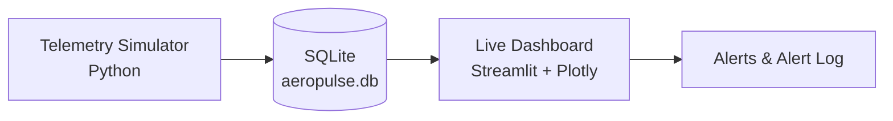

# ✈️ AeroPulse: Real-Time Flight Telemetry Pipeline

AeroPulse simulates aircraft sensor data, stores it in a database, and monitors it live on a dashboard with automatic alerts. It's an end-to-end data pipeline: **generate → store → monitor → alert**.

> **Note:** All data is simulated. No real aircraft or flight data is used.

<!-- Add a screenshot or GIF of the dashboard here, e.g.: -->
<!--  -->

## How it works



1. **Simulator** (`telemetry_simulator.py`) generates one reading per interval and writes it to SQLite.
2. **Database** (`aeropulse.db`) holds every reading, tagged by flight ID and timestamp, with alert flags.
3. **Dashboard** (`dashboard.py`) reads the latest data and refreshes automatically to show gauges, trend charts, and an alert log.

## Features

- **Realistic flight profile.** Each flight moves through climb, cruise, and descent. Values drift smoothly toward phase targets (with noise) instead of jumping randomly.
- **Six sensor channels:** altitude, airspeed, heading, engine temperature, fuel level, and vibration.
- **Fault injection.** Short overheat events are injected at random, raising engine temperature and vibration together so there are real anomalies to detect.
- **Automatic alerts:** `HIGH_ENGINE_TEMP` (above 110 °C), `HIGH_VIBRATION` (above 1.2 g), and `LOW_FUEL` (below 10%).
- **Multi-flight storage.** When a flight finishes, a new flight ID starts. Past flights can be reviewed from the dashboard.
- **Live dashboard** with gauges, trend charts with limit lines, alert markers, a status banner, and an alert log.

## Tech stack

Python · SQLite · pandas · Plotly · Streamlit

## Getting started

### 1. Install dependencies

```bash
pip install -r requirements.txt
```

### 2. Start the simulator (Terminal 1)

```bash
python3 telemetry_simulator.py --interval 0.2
```

Options:

| Flag | Description | Default |
|------|-------------|---------|
| `--interval` | Seconds between readings | `1.0` |
| `--ticks` | Stop after N readings (0 = run forever) | `0` |

A full flight is 600 readings. Press `Ctrl+C` to stop.

### 3. Start the dashboard (Terminal 2)

```bash
python3 -m streamlit run dashboard.py
```

Then open <http://localhost:8501>. Run both commands from the same folder so the dashboard can find `aeropulse.db`.

**Tip:** to generate a lot of data quickly, run `python3 telemetry_simulator.py --interval 0 --ticks 3000`.

## Data schema

Table `telemetry`:

| Column | Description |
|--------|-------------|
| `id` | Auto-incrementing row ID |
| `flight_id` | Unique ID per simulated flight (e.g. `AP-8B773B`) |
| `ts` | UTC timestamp of the reading |
| `phase` | `CLIMB`, `CRUISE`, or `DESCENT` |
| `altitude_ft` | Altitude in feet |
| `airspeed_kts` | Airspeed in knots |
| `heading_deg` | Heading in degrees |
| `engine_temp_c` | Engine temperature in °C |
| `fuel_pct` | Remaining fuel, % |
| `vibration_g` | Vibration in g |
| `alert` | Comma-separated alert flags, or empty |

## Project structure

```
AeroPulse/
├── telemetry_simulator.py   # Generates flight data and writes to SQLite
├── dashboard.py             # Streamlit live dashboard
├── requirements.txt
└── README.md
```

## Roadmap

- [ ] Statistical anomaly detection (rolling z-score) to flag unusual readings beyond fixed thresholds
- [ ] Machine-learning anomaly detection (Isolation Forest)
- [ ] Per-flight summary reports
- [ ] Streaming ingestion with a message queue

## Author

**Ankush Thakur**: M.S. Data Analysis, B.S. Computer Science
[LinkedIn](https://www.linkedin.com/) · [GitHub](https://github.com/)
